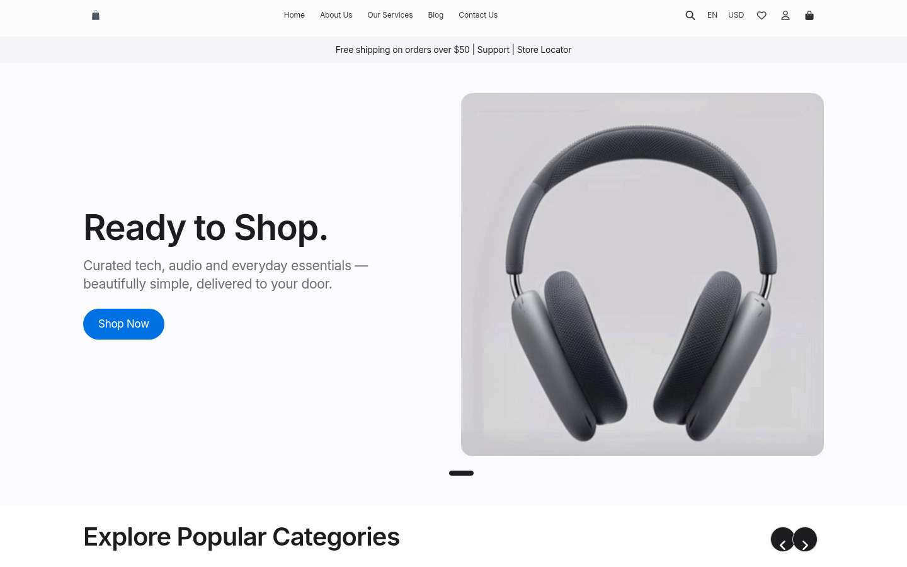
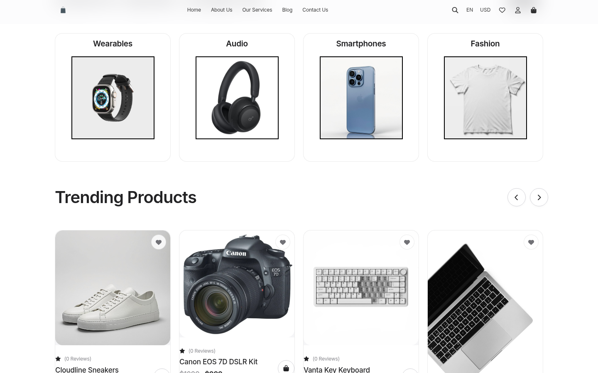
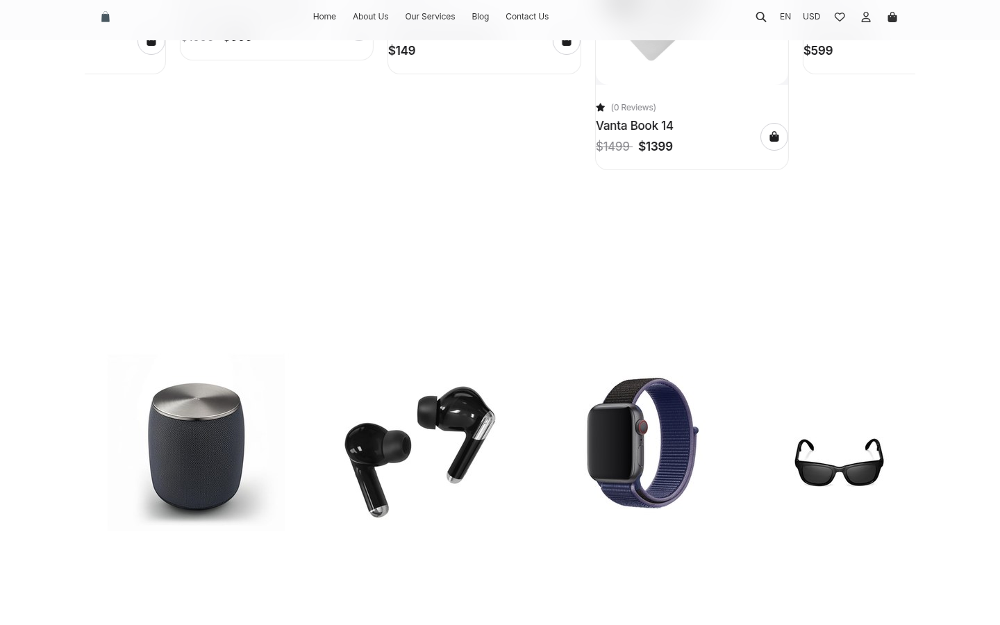
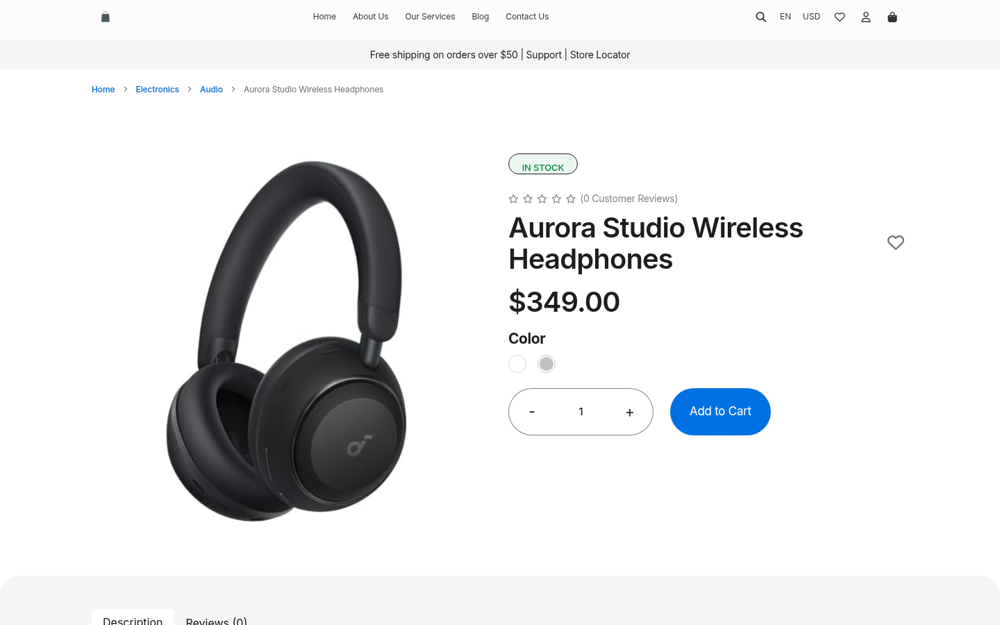
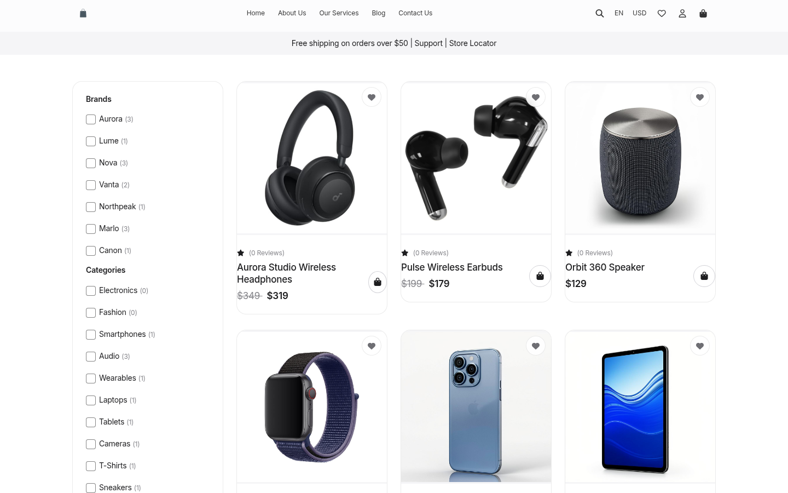

<p align="center">
  
</p>

<h1 align="center">Stora</h1>

<p align="center">
  <strong>Everything you love. In one place.</strong><br>
  An Apple-inspired, white-minimal glassmorphism storefront — built on Laravel.
</p>

<p align="center">
  
  
  
  
</p>

<p align="center">
  
</p>

Stora is a fork of [Velstore](https://github.com/velstorelabs/velstore), the open-source
multi-vendor Laravel eCommerce platform, re-imagined with a premium Apple.com-compatible
theme: alternating white / `#f5f5f7` sections, a translucent glassy sticky navigation
(`backdrop-filter: saturate(180%) blur(20px)`), SF-style typography, pill buttons and
rounded product tiles — with the original logo retained and the store rebranded to **Stora**.

> The seeded catalog contains **real studio product photography only**, curated demo
> brands and honest pricing — no fabricated orders, reviews or revenue numbers anywhere.

## Screenshots

| | |
|---|---|
|  |  |
|  |  |

## Features

- Built with Laravel 10
- Apple.com-style storefront theme (glassmorphism, white minimal)
- Multi-vendor support
- Multi-lingual storefront — translated to 19 languages
- Dedicated Admin, Seller, and Customer panels
- Integrated payment gateways: PayPal and Stripe
- SQLite demo catalog included — zero-database quick start
- One-file Vercel deployment (`api/index.php` + `vercel.json`)

### Supported Languages

<p align="center" style="display: inline;">
    
    
    
    
    
    
    
    
    &nbsp;&nbsp;&nbsp;
    
    
    &nbsp;&nbsp;&nbsp;
    
    
    
    &nbsp;&nbsp;&nbsp;
    
    
    
    
    
    
</p>

## Deploy to Vercel

The repo ships with a ready-made serverless layer (`api/index.php`, `vercel.json`,
`.vercelignore`) powered by the community [vercel-php](https://github.com/vercel-community/php)
runtime (PHP 8.3). The seeded SQLite catalog is bundled with the deployment and
provisioned to a writable `/tmp` copy per instance — no external database required.

[](https://vercel.com/new/clone?repository-url=https%3A%2F%2Fgithub.com%2FMichael-ctrl-eng%2Fstora&project-name=stora&repository-name=stora)

All required environment variables (including `APP_KEY`, SQLite path, cookie sessions,
`/tmp` caches) are pre-configured in `vercel.json` — the deployment needs **no manual
setup**. Just import the repository at [vercel.com/new](https://vercel.com/new) and press
Deploy.

> `vercel.json` pins `"framework": null` so Vercel never applies the Vite preset
> (which expects a `dist/` output). The compiled assets already live in
> `public/build` and the PHP runtime installs Composer dependencies itself.

### Demo accounts

| Panel | URL | Email | Password |
| --- | --- | --- | --- |
| Admin | `/login` | `admin@stora.store` | `stora123` |
| Seller | `/vendor/login` | `seller@example.com` | `abc123` |

> Change these before going live — they are demo credentials for the seeded catalog.

> Vercel Hobby bandwidth applies; static assets are served through the PHP function.

## Local Development

```sh
# 1. PHP dependencies
composer install

# 2. Environment (SQLite by default — no MySQL needed for the demo)
cp .env.example .env
php artisan key:generate
touch database/database.sqlite

# 3. Schema + demo catalog (products, categories, brands, banners — no fake orders)
php artisan migrate:fresh --seed

# 4. Frontend assets
npm install && npm run build

# 5. Serve
php artisan serve
```

Open [http://127.0.0.1:8000](http://127.0.0.1:8000).

For MySQL, point `DB_CONNECTION` / `DB_HOST` / `DB_DATABASE` in `.env` at your database
and re-run the migrations.

### Simulate the Vercel runtime locally

The exact launcher the runtime uses:

```sh
DB_CONNECTION=sqlite DB_DATABASE=/tmp/stora.sqlite SESSION_DRIVER=cookie CACHE_DRIVER=array \
FILESYSTEM_DISK=public LOG_CHANNEL=stderr APP_KEY=base64:XXNk2la7ErHb/WeT859NUQVk7vMqK9cirDpt1hS6FNA= \
VIEW_COMPILED_PATH=/tmp/storage/framework/views \
php -S 127.0.0.1:8080 -t public api/index.php
```

## Tech Stack

- Backend: Laravel 10 (PHP 8.1+)
- Database: MySQL (self-hosted) / SQLite (demo, Vercel)
- Frontend: Blade + Vite, custom `apple.css` design layer
- Authentication: Laravel Sanctum / Laravel UI
- DataTables: Yajra Laravel Datatables
- Deployment: any PHP host, or Vercel via vercel-php

## Credits & License

Stora is a rebranded, re-themed fork of
[Velstore](https://github.com/velstorelabs/velstore) by
[Velstore Labs](https://github.com/velstorelabs) — released under the same license
(see [LICENSE](LICENSE)). Storefront photography and product renders are demo assets
created for this project.
